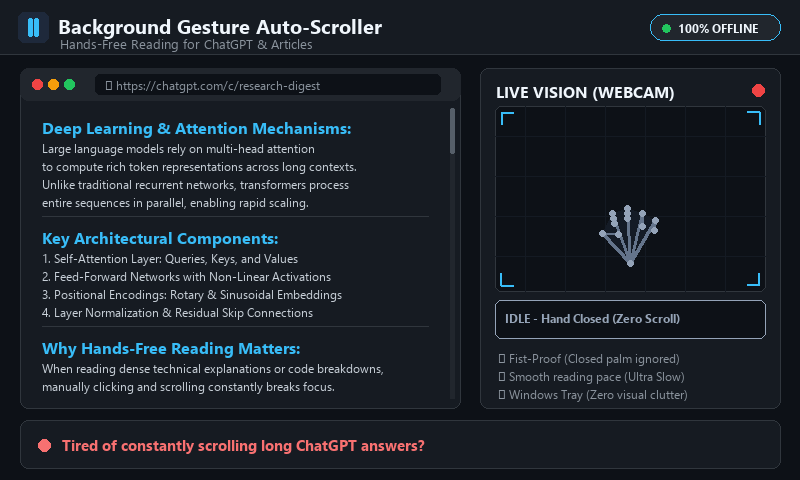

# ✌️ Background Hand Gesture Auto-Scroller

A lightweight, completely free, and 100% offline background utility for Windows that watches your webcam for a **2-finger peace sign** and slowly glides the screen downwards for comfortable hands-free reading.

Designed specifically for reading long responses on **ChatGPT**, blog posts, technical documentation, PDFs, and ebooks without ever touching your mouse or touchpad.

<p align="center">
  
</p>
<p align="center">
  <em>⚡ <b>Live Commercial Demo:</b> ✌ Raise 2 fingers to smoothly auto-scroll line-by-line &bull; ✊ Close your palm into a fist to stop instantly.</em><br>
  <em>(Also available as <a href="assets/demo.mp4">High-Resolution MP4 Video</a>)</em>
</p>

---

## ⚡ Quickstart (Command-Line)

If you prefer using the terminal (PowerShell or Command Prompt), follow these steps:

### 1. Clone the Repository
```bash
git clone https://github.com/Srimanikanta2006/Background-Gesture-Auto-Scroller.git
cd Background-Gesture-Auto-Scroller
```

### 2. Create and Activate Virtual Environment
```powershell
# Create isolated environment
python -m venv .venv

# Activate it (PowerShell)
.\.venv\Scripts\Activate.ps1

# (Optional) If you are using Command Prompt (cmd) instead:
# .venv\Scripts\activate.bat
```

### 3. Install Dependencies
```bash
pip install --upgrade pip
pip install -r requirements.txt
```

### 4. Launch in the Background
```powershell
# Option A: Completely silent background launch (Recommended)
wscript start_silent.vbs

# Option B: Run via pythonw (no terminal window)
.\.venv\Scripts\pythonw.exe main.pyw
```
> The tool is now running silently! Look for the small icon in your **Windows System Tray** (bottom-right of your taskbar, next to the clock).

---

## 🖱️ Quickstart (1-Click GUI Method)

If you don't want to touch the terminal:

1. Download or clone this folder.
2. Double-click **`setup.bat`** (creates the `.venv` and installs all packages automatically).
3. Double-click **`start_silent.vbs`** to launch silently in the background.

---

## 🖐️ Hand Gestures Cheat Sheet

| Gesture | How to Hold Your Hand | What Happens |
|---|---|---|
| **✌ Peace Sign** | **Index + Middle fingers extended up**, Ring & Pinky curled into palm | **Smooth Auto-Scroll Downwards** |
| **✊ Closed Fist / Palm** | All fingers curled inward | **Instant Stop (Idle)** |
| **🖐 Open Palm** | 4 or 5 fingers extended | **Instant Stop (Idle)** |
| **☝ Pointing** | Only Index finger extended | **Instant Stop (Idle)** |

> **Palm Safety Feature**: Closed palms or loose fists will **never** trigger scrolling. The engine calculates bone elongation ratios and requires exact 2-finger alignment before sending any scroll pulse.

---

## 🎛️ System Tray Menu & Controls

Right-click the circular icon in your Windows Taskbar Tray (near the clock) to access the menu:

* **Pause / Resume Detection**: Temporarily freeze gesture tracking without quitting.
* **Scroll Speed**:
  * `Ultra Slow (Reading Speed - Recommended)`: Gentle line-by-line reading speed (~3 ticks / pulse).
  * `Slow (Comfortable Reading)`: Smooth teleprompter speed (~6 ticks / pulse).
  * `Normal (Glide)`: Faster skimming speed (~15 ticks / pulse).
  * `Fast`: Quick navigation (~35 ticks / pulse).
* **Show Camera Test (Preview)**: Opens a live preview window with your hand landmarks drawn. Press `q` to close.
* **Exit Gesture Scroller**: Cleanly frees your webcam and terminates the background process.

---

## 🧪 Testing & Diagnostics

### 1. Visual Camera & Gesture Test
Test your webcam lighting and verify gesture detection with live diagnostic banners:
```powershell
.\.venv\Scripts\python.exe test_camera.py
```
* Shows `2 Fingers (Peace) -> SCROLLING` when active.
* Shows `Closed Palm / Fist -> IDLE` when palm is closed.
* Press **`q`** to close the preview window.

### 2. Run Automated Unit Tests
Run the deterministic geometric test suite (requires no camera, runs in < 0.3s):
```powershell
.\.venv\Scripts\python.exe -m unittest discover tests
```

---

## 🛑 Stopping the Background App

To stop the background process at any time:

### Using the Batch Script:
Double-click **`stop.bat`**.

### Or via PowerShell:
```powershell
Get-CimInstance Win32_Process | Where-Object { $_.CommandLine -like '*main.pyw*' } | Stop-Process -Force
```

---

## 🔒 Security & Privacy

* **100% Offline**: All computer vision runs locally on your CPU using Google MediaPipe.
* **Zero Telemetry**: No camera frames, images, or metrics are ever saved to disk or transmitted over the internet.
* **Single-Instance Mutex**: Uses native Windows `CreateMutexW` to prevent duplicate background instances from competing for your webcam.
* **PyAutoGUI Fail-Safe**: Moving your mouse cursor forcefully to any corner of your monitor instantly stops mouse events.

---

## 🛠️ Troubleshooting

| Problem | Cause | Solution Command / Action |
|---|---|---|
| Camera not opening | Another app (Zoom, Teams, Chrome) is using it | Close other camera apps and restart with `start_silent.vbs` |
| `setup.bat` fails | Python not installed or not in system PATH | Install Python 3.10 or 3.11 from [python.org](https://www.python.org/) and check **"Add Python to PATH"** |
| Execution Policy Error in PowerShell | PowerShell script execution restricted | Run `Set-ExecutionPolicy -Scope Process -ExecutionPolicy Bypass` before activating `.venv` |
| Process won't stop | Process running under another PID | Run `stop.bat` or kill via PowerShell command shown above |
